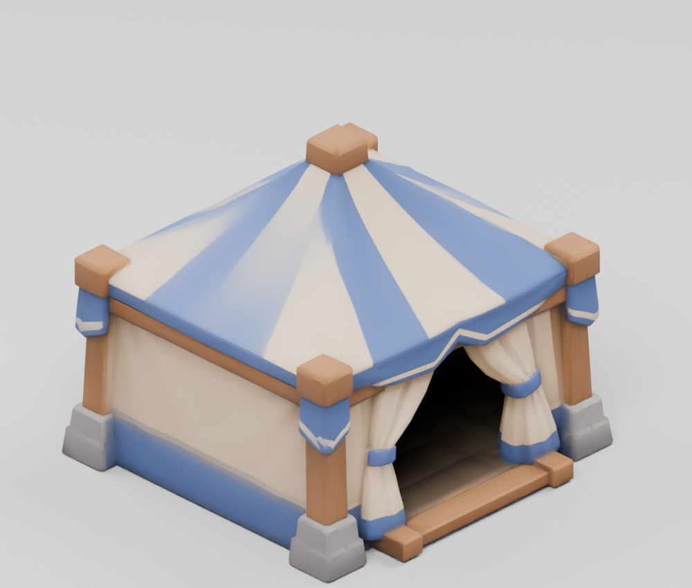
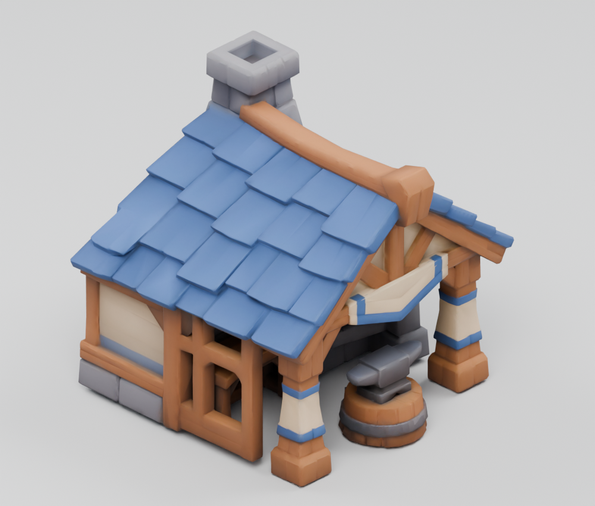
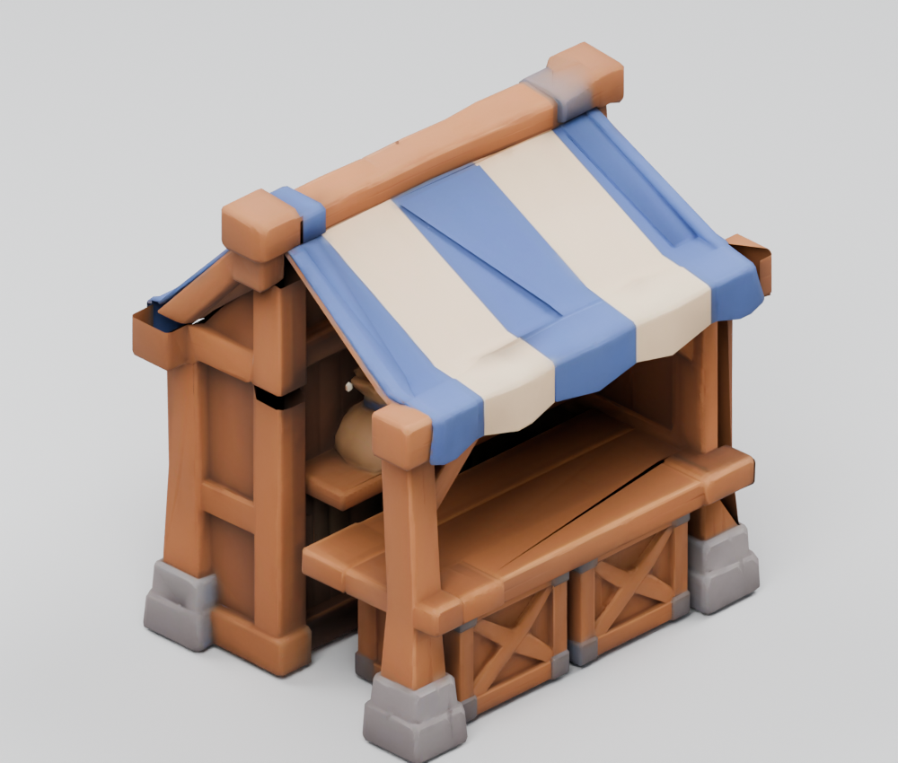

# 중앙 베이스캠프 건물 3종 — Tripo 초안

제작일: 2026-11-18

확장형 대륙 맵 A의 중앙 거점용 첫 에셋 세트. 파란색·크림색 천, 갈색 목재, 회색 돌을 공통으로 사용했다.

## 제작 방법과 비용

- 참조 이미지: built-in image_gen으로 건물별 단독 이미지 생성. 전체 프롬프트는 [reference-prompts.md](reference-prompts.md).
- 실제 3D: Tripo CLI의 이미지 → 모델, H3.1 (`v3.1-20260211`), `smart_low_poly=true`, `face_limit=8000`, 표준 텍스처 포함, PBR 맵 제외.
- 각 40크레딧, 총 120크레딧. 시작 925 → 완료 후 사용 가능 805, 예약 0.
- 유료 재생성·리깅·애니메이션·포맷 변환 요청은 하지 않았다. FBX는 Blender에서 로컬 변환했다.

## 실제 3D 모델 렌더

아래 이미지는 참조 시안이 아니라 다운로드한 GLB를 Blender에서 다시 렌더한 결과다. 각 Review 폴더에 반대쪽 시점 `view-b.png`도 있다.

### 캠프 텐트

[FBX](Review/camp-tent/camp-tent.fbx) · [원본 GLB](Models/camp-tent/tripo-out/camp-tent-v1-3e22fcb8/model.glb) · [Blender 검토 파일](Review/camp-tent/camp-tent-review.blend)

### 대장간

[FBX](Review/blacksmith/blacksmith.fbx) · [원본 GLB](Models/blacksmith/tripo-out/blacksmith-v1-c72d2b75/model.glb) · [Blender 검토 파일](Review/blacksmith/blacksmith-review.blend)

### 보급 상점

[FBX](Review/supply-stall/supply-stall.fbx) · [원본 GLB](Models/supply-stall/tripo-out/supply-stall-v1-56b001f5/model.glb) · [Blender 검토 파일](Review/supply-stall/supply-stall-review.blend)

## 확인 결과와 적용 범위

| 에셋 | 실제 삼각형 수 | 메시 / 재질 | 검토용 임시 크기: X × Y × 높이 (m) |
|---|---:|---|---|
| 캠프 텐트 | 8,921 | 1 / 1 | 4.96 × 5.00 × 4.45 |
| 대장간 | 9,499 | 1 / 1 | 4.00 × 3.88 × 3.54 |
| 보급 상점 | 12,152 | 1 / 1 | 2.02 × 2.50 × 2.53 |

크기는 Blender의 Z-up 기준이며 캐릭터와의 비율을 확정한 값이 아니다. FBX는 Y-up으로 내보냈다. 요청한 face_limit은 8,000이지만 실제 삼각형 수는 이를 초과하므로 엄격한 최적화 예산을 충족했다고 보지 않는다. 원본 GLB는 수정하지 않았고 Review 파일만 임시 크기로 맞췄다.

- 세 모델의 원본 GLB를 Blender에서 열고 텍스처와 두 방향 렌더를 확인했다.
- 텐트는 열린 입구와 막힌 뒷면이 표현되었다. 실제 캐릭터의 내부 진입 및 카메라 가림은 아직 검증하지 않았다.
- 대장간은 지붕·굴뚝·모루가 표현되었다. 화로 불빛은 참조 이미지보다 약하다. 불·연기 효과는 별도 제작 대상이다.
- 보급 상점은 처마 일부가 휘고 목재 접합부에 틈이 보여 가까이서 사용할 경우 메시 정리가 필요하다.
- 건물 하나가 메시 하나로 생성되었다. 포함된 모루·상자·천막 등을 개별 이동하거나 교체하려면 분리 또는 별도 프랍 제작이 필요하다.
- Unity 씬 배치, 콜라이더, NavMesh, LOD, 상호작용, URP 재질 설정은 이번 범위에 포함하지 않았다. Blender에서 확인한 초안이며 Unity 최종 적용 검증은 별도다.
- 로컬 렌더 중 Blender 사용자 썸네일/확장 캐시 폴더 쓰기 경고가 있었지만, 작업 폴더 내 PNG·FBX·blend 저장은 완료됐다.

[작업 ID와 요청 옵션](generation-manifest.json) · [실제 메시 검사 결과](inspection.json)
