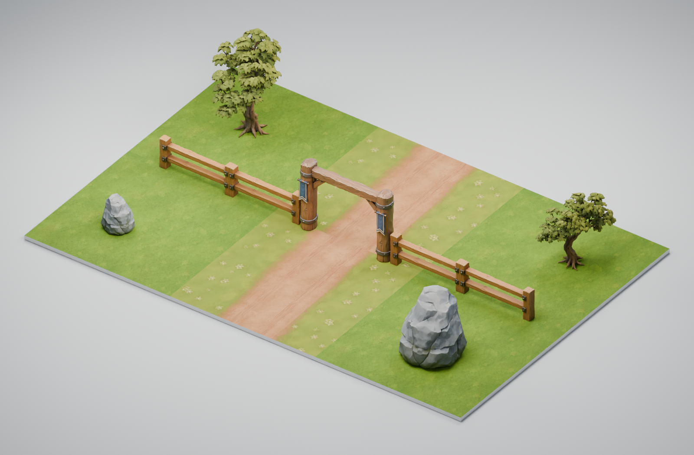
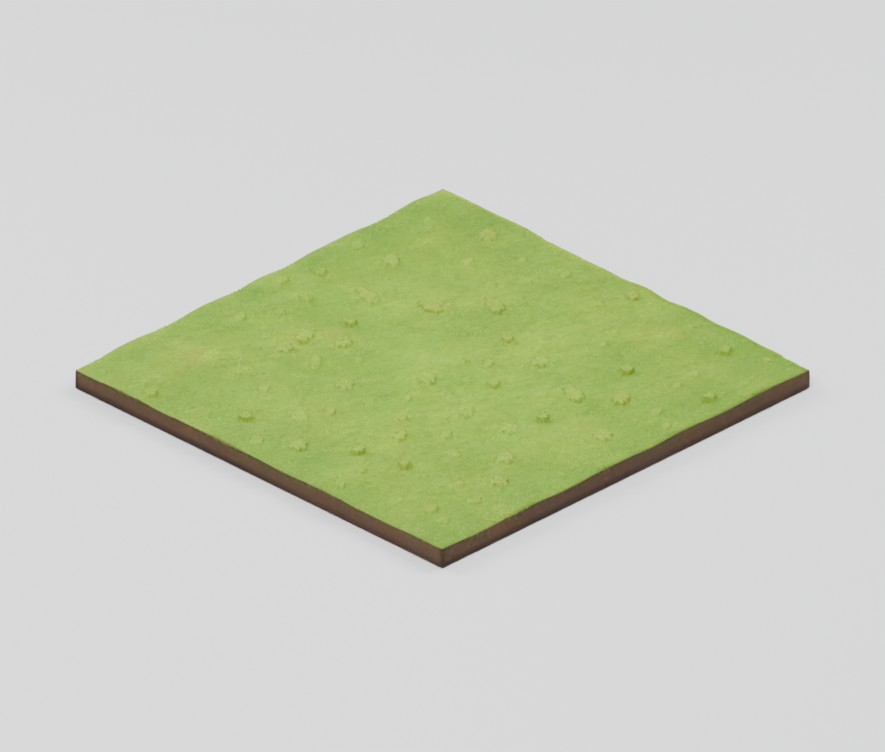
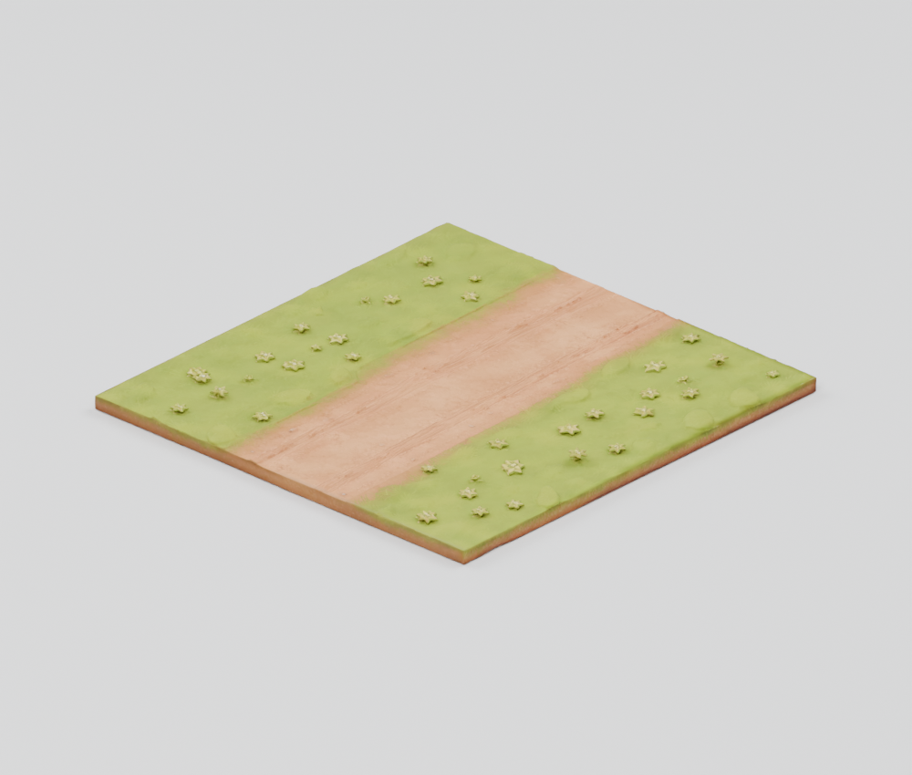
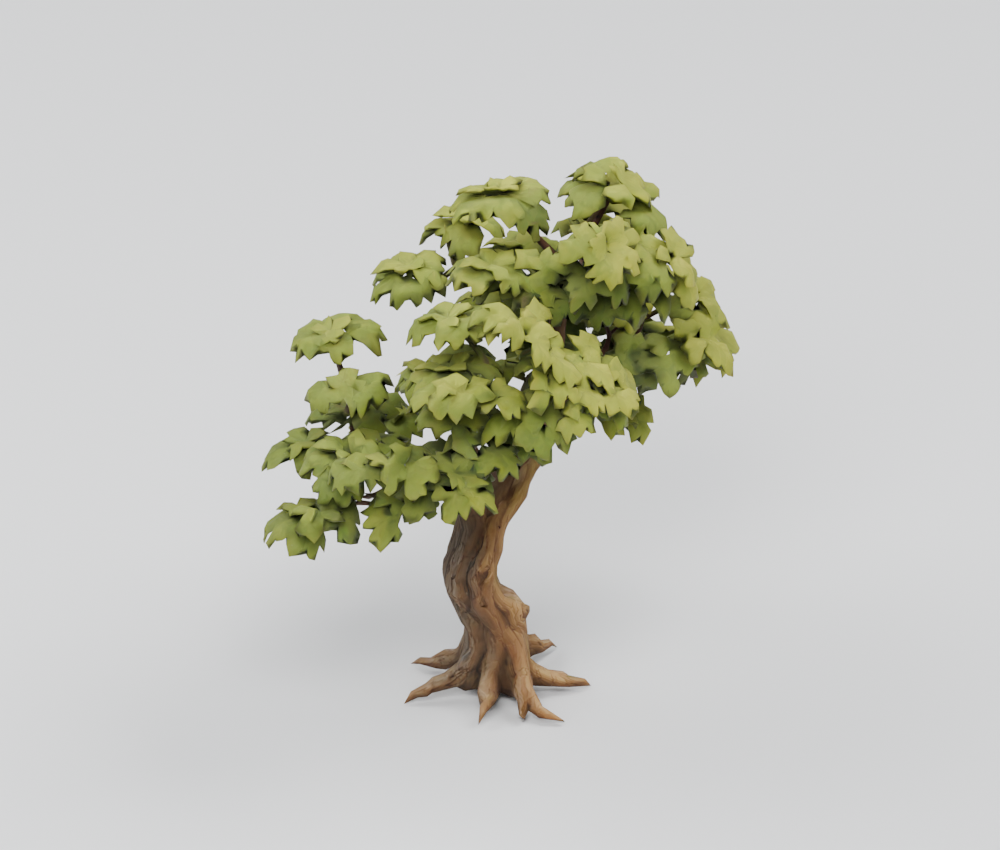
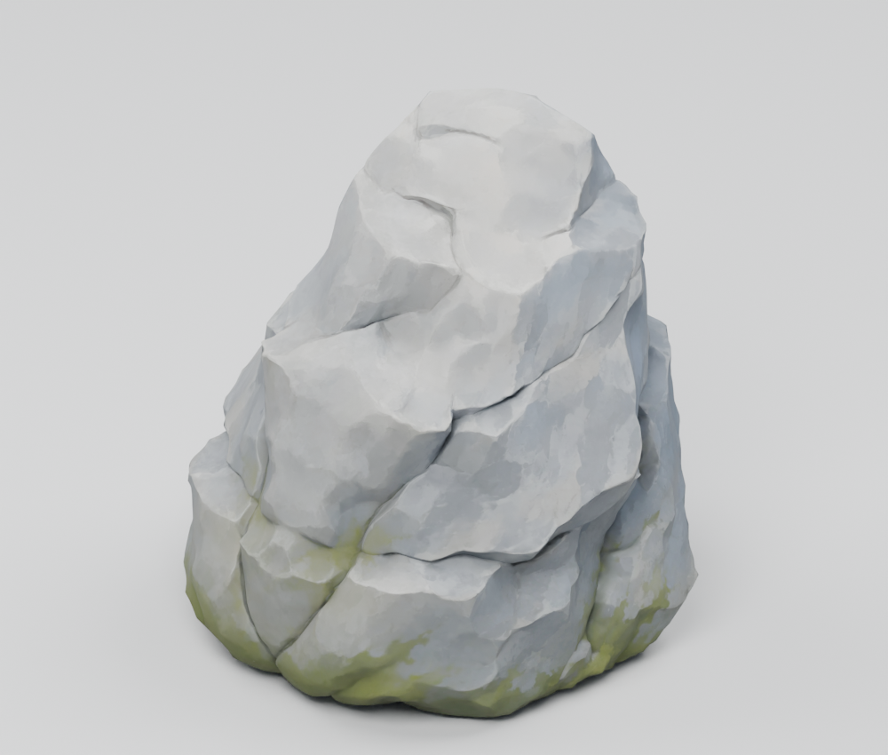
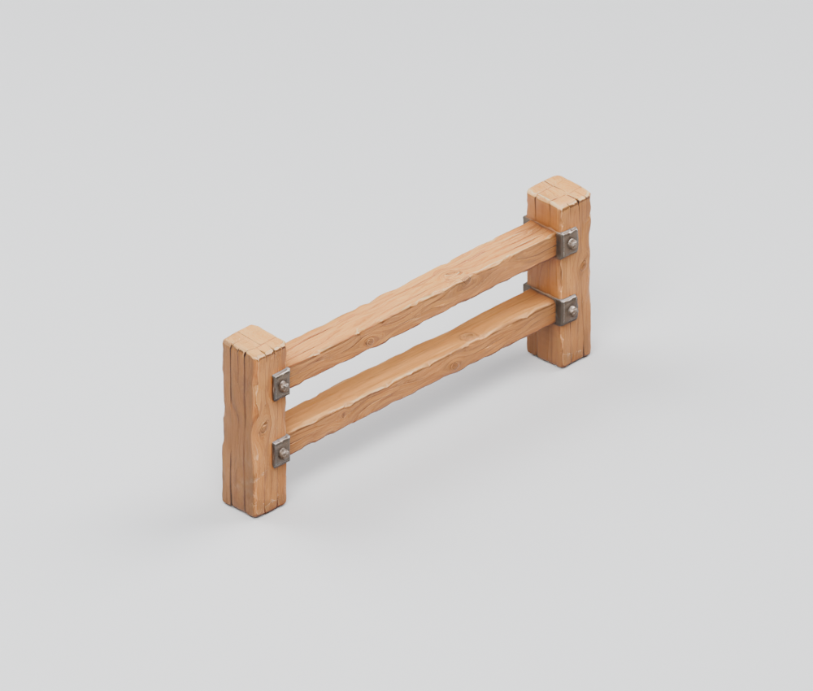
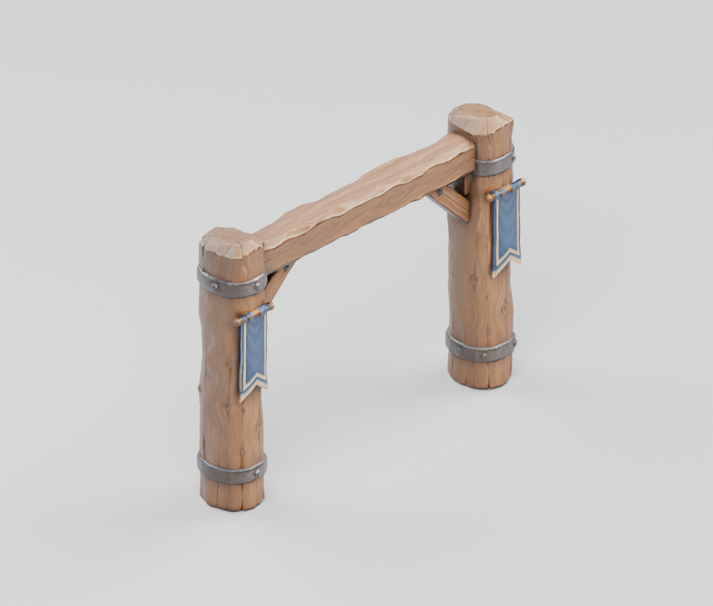

# 확장형 맵 환경 프랍 6종 — 중간 디테일

제작일: 2026-11-18

요청: 중앙 캠프와 동서남북 사냥터를 가진 확장형 대륙 맵에 사용할 땅·나무·울타리 등. 이전 건물보다 형태와 표면 디테일을 높인 스타일로 제작했다.

## 전체 배치 예시

Tripo에서 받은 실제 3D 모델과 정리한 바닥 모듈을 Blender에서 배치하고 렌더한 화면이다. 완성된 월드나 Unity 실행 화면은 아니며 연결·크기·색감 비교용이다. [Blender 배치 파일](Showcase/environment-kit-placement.blend)

## 구성

| 에셋 | 원본 삼각형 | FBX | 원본 GLB |
|---|---:|---|---|
| 초지 바닥 | 22,940 | [FBX](Review/grass-ground/grass-ground.fbx) | [GLB](Models/grass-ground/tripo-out/grass-ground-v1-7c27f5a0/model.glb) |
| 흙길 바닥 | 22,134 | [FBX](Review/dirt-path-ground/dirt-path-ground.fbx) | [GLB](Models/dirt-path-ground/tripo-out/dirt-path-ground-v1-581242ab/model.glb) |
| 활엽수 | 22,888 | [FBX](Review/oak-tree/oak-tree.fbx) | [GLB](Models/oak-tree/tripo-out/oak-tree-v1-29a6781f/model.glb) |
| 이끼 바위 | 23,540 | [FBX](Review/granite-rock/granite-rock.fbx) | [GLB](Models/granite-rock/tripo-out/granite-rock-v1-129cb5ff/model.glb) |
| 직선 목재 울타리 | 21,876 | [FBX](Review/timber-fence/timber-fence.fbx) | [GLB](Models/timber-fence/tripo-out/timber-fence-v1-87df74cc/model.glb) |
| 캠프 출입구 | 23,320 | [FBX](Review/camp-gateway/camp-gateway.fbx) | [GLB](Models/camp-gateway/tripo-out/camp-gateway-v1-d585ad48/model.glb) |

### 초지 바닥

[반대쪽](Review/grass-ground/view-b.png) · [검토용 blend](Review/grass-ground/grass-ground-review.blend)

### 흙길 바닥

[반대쪽](Review/dirt-path-ground/view-b.png) · [검토용 blend](Review/dirt-path-ground/dirt-path-ground-review.blend)

### 활엽수

[반대쪽](Review/oak-tree/view-b.png) · [검토용 blend](Review/oak-tree/oak-tree-review.blend)

### 이끼 바위

[반대쪽](Review/granite-rock/view-b.png) · [검토용 blend](Review/granite-rock/granite-rock-review.blend)

### 직선 목재 울타리

[반대쪽](Review/timber-fence/view-b.png) · [검토용 blend](Review/timber-fence/timber-fence-review.blend)

### 캠프 출입구

[반대쪽](Review/camp-gateway/view-b.png) · [검토용 blend](Review/camp-gateway/camp-gateway-review.blend)

## 바로 연결해 배치할 바닥 파생본

Tripo 원본 지면은 크기가 불규칙하고 약간 울퉁불퉁해 별도 보존했다. 확장용으로는 평평한 정사각형 바닥 두 개를 추가로 만들었다.

- 초지: [8m FBX](Modules/grass-ground/grass-ground-8m.fbx) · [8m GLB](Modules/grass-ground/grass-ground-8m.glb)
- 흙길: [8m FBX](Modules/dirt-path-ground/dirt-path-ground-8m.fbx) · [8m GLB](Modules/dirt-path-ground/dirt-path-ground-8m.glb)
- 두 바닥 모두 가로 8m, 세로 8m, 두께 0.2m. 윗면 높이 0, 중앙 피벗, 12삼각형. 높이와 외곽 규격을 일치시켜 8m 간격으로 이어 배치할 수 있다.
- 바닥은 평평한 면이므로 불필요한 폴리곤을 줄이고 표면 표현을 텍스처로 옮겼다. 실제 Tripo 모델의 내부 영역을 위에서 색상 렌더해 1536px 알베도로 사용했다. AI 참조 시안을 그대로 붙인 바닥이 아니다.
- 파생본은 원본 PBR 맵을 이전하지 않은 단순 무광 재질이다. 원본 GLB에는 생성된 PBR 재질이 보존되어 있다.
- **외곽 규격과 높이는 맞췄지만 텍스처 경계를 완전한 심리스로 처리한 것은 아니다.** 흙길과 초지 사이 색 차이, 흙길 폭과 경계의 미세한 불연속이 배치 예시에 보인다. 최종 맵에서는 전환 재질·데칼 등으로 다듬을 부분이다.
- 바닥 양 끝의 직선 경로를 계속 연결하는 기본 모듈이다. 곡선·갈림길·사거리·경사 지형은 이번 생성 범위에 포함하지 않았다.

## 스타일과 확인 결과

- H3.1, smart_low_poly=false, face_limit=24000, 상세 텍스처, PBR 포함으로 생성했다. 이전 건물 8,921~12,152삼각형보다 형상 예산과 표면 표현을 높였다.
- 원본 여섯 모델을 Blender에서 열어 텍스처와 두 방향 렌더를 확인했다. 나뭇결, 수피, 잎 덩어리, 돌의 큰 균열을 표현했다.
- 나무의 수관은 방향에 따라 폭이 크게 달라지고 잎 덩어리는 스타일화되어 있다. 숲을 넓게 구성할 때는 형태가 다른 추가 나무가 필요하다. 이번에는 나무 1종을 제작했으며 배치 예시의 두 나무는 크기·회전을 달리한 같은 모델이다. 바위도 동일 원본의 배치 변형이다.
- 울타리는 길이 약 4m, 출입구는 폭 약 5m로 정규화했다. 두 모델 모두 긴 방향은 Blender 로컬 Y축이다. 직선 연속 배치 시 양끝 기둥이 겹치지 않도록 간격을 조정한다. 코너와 경사 대응은 별도다.
- 개별 모델은 단일 메시로 생성되었다. 자동 LOD·바람 애니메이션·충돌·NavMesh·Unity URP 재질 설정은 아직 하지 않았다.
- 이번 결과는 에셋 검토용이다. Unity 씬은 변경하지 않았다. 나무를 다수 배치하기 전에는 실제 기기에서 성능과 카메라 가림을 확인해야 한다.

## 비용과 재현 정보

- 시작 805 → 실제 사용 240 → 완료 후 사용 가능 **565**, 예약 0.
- 각 40크레딧. 유료 재생성 및 추가 처리 요청 없음. 바닥 규격 정리·FBX 변환·배치 렌더는 로컬 Blender 작업이다.
- 이미지 참조 생성: built-in image_gen. [최종 프롬프트 6개](reference-prompts.md)
- 3D 생성 요청: [매니페스트 및 작업 ID](generation-manifest.json)
- [실제 메시 검사](inspection.json) · [바닥 모듈 설명](Modules/inspection.json)

